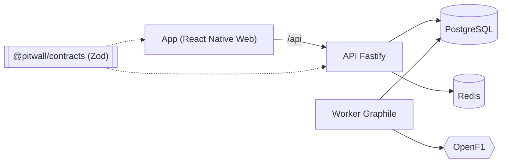

<div align="center">

# 🏁 Pitwall

**Lire une course de Formule 1 comme un ingénieur.**

Analyse de la performance de chaque pilote, sur chaque Grand Prix : rythme de course réel,
dégradation des pneus corrigée du carburant, régularité, stratégie et duels tour par tour.

TypeScript de bout en bout · Node.js · Fastify · Zod · Kysely · ts-pattern · PostgreSQL · Graphile Worker · Redis · React Native Web · Docker · Task

</div>

---

## Démarrage — 1 commande

Prérequis : [Docker](https://docs.docker.com/get-docker/) et [Task](https://taskfile.dev/installation/).

```bash
task start
```

| | URL |
| --- | --- |
| 🏎️ Application | http://localhost:8080 |
| 📘 Référence API (OpenAPI / Scalar) | http://localhost:3000/docs |
| 📚 Documentation technique | http://localhost:4000 |

`task start` construit et démarre la stack, puis importe la saison 2024 depuis [OpenF1](https://openf1.org) en tâche de fond
(~5 min, rate-limit de l’API publique — les courses apparaissent au fur et à mesure).
`task sync YEARS="2023 2025"` importe d’autres saisons. `task` liste toutes les commandes.

## Ce que montre l’application

- **Saison** — calendrier, statut d’import de chaque Grand Prix en temps réel.
- **Course** — vainqueur, meilleur tour, meilleur *rythme* (≠ meilleur tour), pilote le plus régulier, plus belle remontée ;
  évolution des positions tour par tour ; classement au rythme médian ; tableau de performance complet.
- **Pilote** — temps au tour colorés par gomme, tours exclus mis en évidence, superposition avec n’importe quel rival
  (coéquipier par défaut), écart cumulé, duel tour par tour, stratégie et dégradation par relais, arrêts, secteurs.

La méthodologie (règle des 107 %, régression par relais, correction carburant…) est détaillée dans
[`docs/domain/methodology.md`](docs/domain/methodology.md).

## Architecture

```
apps/
  api/        Node 24 · Fastify 5 — monolithe modulaire, Screaming Architecture
    src/races/         catalogue des saisons et courses
    src/performance/   ★ cœur métier : domain/ = fonctions pures testées
    src/ingestion/     import OpenF1 : client typé throttlé, jobs Graphile Worker
    src/platform/      config Zod, Kysely, cache Redis, HTTP/OpenAPI
    src/main/          points d'entrée : server · worker · migrate · sync
  web/        Expo Router · React Native Web · TanStack Query · graphiques SVG maison
packages/
  contracts/  schémas Zod partagés API ↔ app (validation + types + OpenAPI)
docs/         VitePress + Mermaid : guides, architecture, ADR
load-tests/   scénario k6
```



Points clés — chacun justifié par un [ADR](docs/adr/) :

- **Type-safety de bout en bout** : un contrat Zod valide l’entrée de l’API, sa sortie, génère l’OpenAPI, et revalide la réponse côté app.
- **Domaine pur** : `performance/domain` n’importe ni SQL ni HTTP ; il est testé unitairement en ~100 ms.
- **Jobs ACID** : la file de jobs est dans PostgreSQL ; ingestion idempotente, dédupliquée, avec retry et respect du rate-limit.
- **Compute-on-read + cache** : faire évoluer un algorithme ne demande pas de ré-import.

## Qualité

```bash
task ci           # Biome (lint + format) · tsc strict sur chaque package · Vitest
task load-test    # k6 : 50 VUs, seuils p95 par endpoint
```

CI GitHub Actions : lint → typecheck → tests → build des 3 images Docker.

## Développement local

```bash
task dev:infra    # Postgres + Redis en Docker
task dev:api      # API en hot-reload        (+ task dev:worker)
task dev:web      # Expo : web :8081, iOS / Android via Expo Go
```

---

<sub>Données : [OpenF1](https://openf1.org), API non officielle. Projet non affilié à la Formula 1.</sub>
