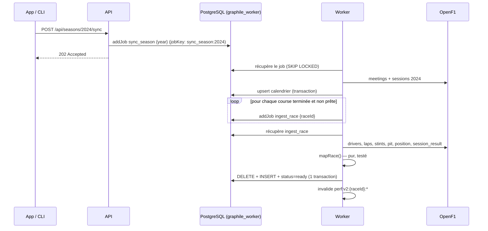

# Ingestion & jobs

## Pourquoi en tâche de fond

Une course représente ~1 000 tours et 6 appels OpenF1, et l’API publique limite les clients anonymes. Faire ça dans une requête HTTP serait lent et fragile : on délègue à un **worker**.

## Garanties

| Propriété | Comment |
| --- | --- |
| **Idempotence** | Une ingestion remplace toutes les lignes de la course dans une transaction. La rejouer donne le même état. |
| **Déduplication** | `jobKey` unique par saison / course : cliquer 10 fois n’empile pas 10 jobs. |
| **Retry** | 3 tentatives avec backoff exponentiel (Graphile), statut `failed` + `last_error` visibles. |
| **Rate-limit** | Le client OpenF1 sérialise les appels (délai minimum configurable) et respecte `Retry-After` sur un 429. |
| **Robustesse du schéma** | Chaque payload est validé par Zod : un changement d’OpenF1 casse le job, jamais la base. |
| **Cohérence du cache** | Le cache de la course est purgé après le commit. |

## Positions par tour

OpenF1 publie les positions comme une **timeline de changements**, pas par tour. `resolveLapPositions()` projette cette timeline : la position à la fin du tour *n* est le dernier échantillon antérieur au passage sur la ligne (`date_start + lap_duration`), trouvé par recherche dichotomique. La position sur la grille est le premier échantillon (pré-course).
