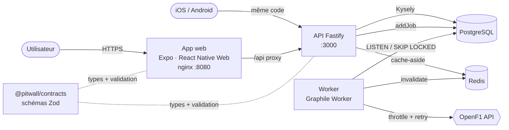
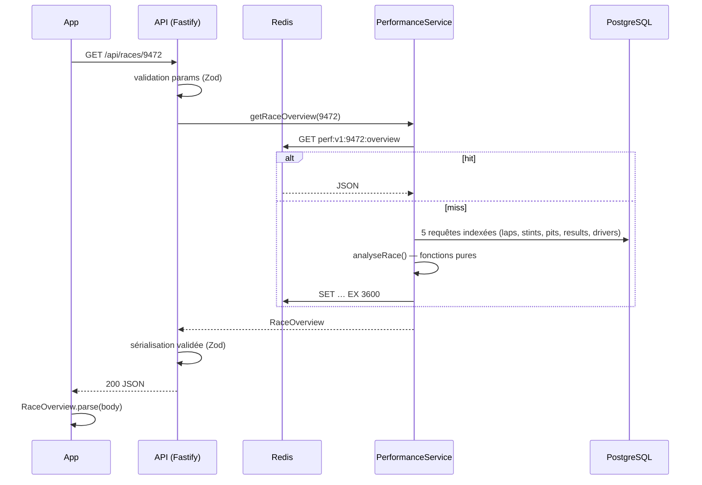

# Vue d’ensemble

Pitwall est un **monolithe modulaire** TypeScript : une seule image API qui expose quatre points d’entrée (serveur HTTP, worker, migrations, CLI), une app React Native compilée pour le web, et un package de contrats partagé.

## Les briques

| Brique | Techno | Rôle |
| --- | --- | --- |
| `apps/api` | Node 24, Fastify 5, Kysely, Zod, ts-pattern | HTTP, jobs, migrations |
| `apps/web` | Expo Router, React Native Web, TanStack Query, react-native-svg | Interface web + mobile |
| `packages/contracts` | Zod 4 | Source unique de vérité des payloads |
| PostgreSQL 17 | — | Données **et** file de jobs (Graphile Worker) |
| Redis 7 | ioredis | Cache des analyses |
| `docs` | VitePress + Mermaid | Cette documentation |

## Cycle de vie d’une requête

## Choix structurants

Chaque décision non triviale est tracée dans un [ADR](/adr/). En résumé :

- **Monolithe modulaire** plutôt que micro-services : une équipe, un déploiement, des frontières dans le code.
- **PostgreSQL fait aussi la queue** : un job est écrit dans la même transaction que les données, sans *dual write*.
- **L’analyse est calculée à la lecture** puis mise en cache : on peut faire évoluer un algorithme sans ré-ingérer.
- **Le domaine ne connaît ni SQL ni HTTP** : il reçoit des types métier, il est testable en millisecondes.
