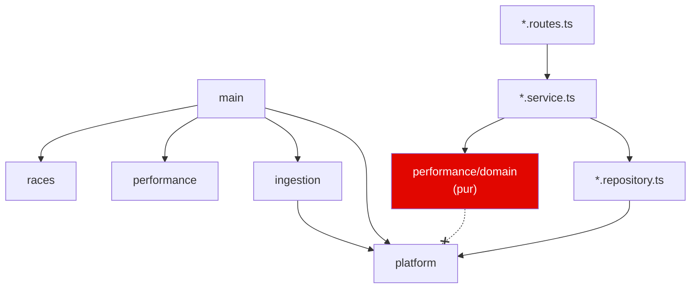

# Screaming Architecture

> « L’architecture doit crier l’intention du système, pas le framework utilisé. » — Robert C. Martin

L’arborescence de l’API se lit comme le produit : **des courses, de la performance, de l’ingestion**. Les couches techniques (`controllers/`, `services/`, `models/`) n’existent pas au premier niveau.

```
apps/api/src/
├── races/                     # Catalogue : saisons, calendrier, statut d'import
│   ├── race.repository.ts
│   └── races.routes.ts
├── performance/               # ★ Cœur métier : analyse des pilotes
│   ├── domain/                # Fonctions pures — aucune I/O
│   │   ├── lap-classification.ts   # quels tours sont représentatifs
│   │   ├── driver-analysis.ts      # rythme, régularité, relais, dégradation
│   │   ├── race-overview.ts        # classement de rythme, faits marquants
│   │   ├── driver-comparison.ts    # duel tour par tour, écart cumulé
│   │   ├── statistics.ts / tyres.ts / types.ts
│   │   └── *.test.ts
│   ├── performance.repository.ts   # SQL → types du domaine
│   ├── performance.service.ts      # orchestration + cache
│   └── performance.routes.ts       # HTTP
├── ingestion/                 # Import OpenF1 en tâche de fond
│   ├── openf1/                # client typé, throttlé, retry + schémas Zod
│   ├── lap-positions.ts       # projection de la timeline des positions sur les tours
│   ├── race-mapping.ts        # payloads OpenF1 → lignes SQL (pur, testé)
│   ├── race-ingestion.ts      # transaction de remplacement idempotente
│   ├── season-sync.ts         # calendrier + liste des courses à importer
│   ├── jobs.ts / job-queue.ts # Graphile Worker
├── platform/                  # Noyau technique partagé (le seul « horizontal »)
│   ├── config.ts  logger.ts  cache.ts  errors.ts
│   ├── db/  (schema, migrations, migrator)
│   └── http/app.ts            # composition Fastify, OpenAPI, gestion d'erreurs
└── main/                      # Points d'entrée : server, worker, migrate, sync
    └── container.ts           # injection de dépendances manuelle
```

## Règles de dépendance



- `performance/domain` n’importe **rien** d’autre que `@pitwall/contracts` et `ts-pattern`. C’est vérifiable en une ligne de `grep`.
- Les repositories traduisent les lignes SQL en types du domaine (`LapInput`, `StintInput`…). Changer de schéma ne touche pas l’analyse.
- `main/container.ts` assemble tout explicitement : pas de décorateurs, pas de conteneur IoC magique.

## Pourquoi c’est utile en équipe

- **Onboarding** : un nouvel arrivant trouve où travailler en lisant les noms de dossiers.
- **Ownership** : un dossier = un domaine = une squad possible.
- **Revue** : un diff qui touche `performance/domain` et `platform/db` en même temps mérite une question.
