# Type-safety de bout en bout

Objectif : **qu’une incohérence entre la base, l’API et l’interface soit une erreur de compilation**, pas un bug en production.

```mermaid
flowchart LR
  openf1{{OpenF1 JSON}} -->|"Zod parse (ingestion)"| rows[Lignes typées Kysely]
  rows -->|"Kysely Database interface"| pg[(PostgreSQL)]
  pg -->|"requêtes typées"| domain[Types du domaine]
  domain -->|"RaceOverview (contrat)"| fastify[Sérialisation Fastify + Zod]
  fastify -->|JSON| client["api.overview()<br/>RaceOverview.parse()"]
  client --> ui[Composants React Native]
```



## Un contrat, trois usages

`packages/contracts/src/performance.ts` :

```ts
export const DriverRaceSummary = z.object({
  driver: DriverRef,
  result: DriverResult,
  pace: PaceMetrics,
  pitStops: z.number().int(),
  paceRank: z.number().int().nullable().describe('Rank by median race pace (1 = fastest)'),
  paceDeltaToBest: Seconds.nullable(),
})
export type DriverRaceSummary = z.infer<typeof DriverRaceSummary>
```

1. **Côté API**, le schéma est déclaré sur la route : Fastify valide les entrées, *sérialise* la sortie en la validant, et le handler doit retourner exactement ce type.
2. **OpenAPI** est généré depuis ces mêmes schémas (`.describe()` devient la doc de chaque champ) — voir <http://localhost:3000/docs>.
3. **Côté app**, `request(path, RaceOverview)` parse la réponse : si l’API dérive, l’erreur est explicite et localisée.

## Aux frontières, on valide

| Frontière | Outil |
| --- | --- |
| Variables d’environnement | `z.object(...)` au boot, *fail fast* |
| Payloads OpenF1 | schémas `OpenF1*` — un champ inattendu fait échouer le job, pas la base |
| Params / query HTTP | `fastify-type-provider-zod` |
| Payload des jobs | `SyncSeasonPayload.parse(payload)` |
| Réponses API côté client | `schema.parse(body)` |

## Au centre, on modélise

- `ts-pattern` pour les correspondances exhaustives (statut de résultat, gommes, mapping d’erreurs HTTP).
- `noUncheckedIndexedAccess` activé : `array[i]` est `T | undefined`, on gère le cas.
- Aucun `any` (règle Biome en erreur), aucun `!` non justifié.
